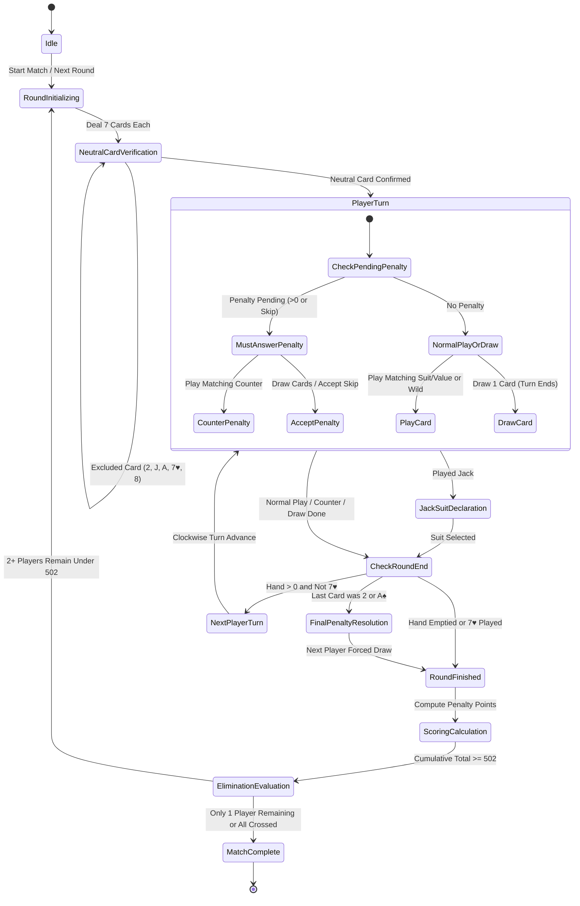

# OUTLAST 502 — System & Engine Architecture

## 1. Architectural Philosophy
OUTLAST 502 enforces strict separation of concerns between:
1. **Core Game Engine**: Pure, deterministic, platform-agnostic TypeScript functions and state reducers. Zero React or React Native dependencies. Fully testable in Node.js via Jest.
2. **Game State Management**: Predictable state transitions, action dispatchers, event logging, and turn progression hooks.
3. **Computer Opponent (AI) Logic**: Deterministic, rule-compliant decision engine supporting multi-level heuristics (conservative vs aggressive card shedding).
4. **Presentation Layer (React Native / Expo)**: Custom Art Deco club UI with ink/emerald atmospheric backdrops, warm ivory cards, restrained brass detailing, animated transitions, modal dialogs, scoreboard, and haptic feedback.
5. **Persistence & Firebase Integration**: Abstracted storage interface supporting local offline persistence with optional cloud sync to Google Cloud Firestore.

---

## 2. Directory Structure & Module Boundaries

```
Outlast502/
├── src/
│   ├── types/
│   │   ├── card.ts             # Card, Suit, Rank, CardId models
│   │   ├── game.ts             # GameState, Player, Round, Penalty, Action types
│   │   └── history.ts          # Score history record models
│   ├── engine/
│   │   ├── deck.ts             # 52-card standard deck, neutral opening card filter
│   │   ├── rules.ts            # Legal move validator, matching rules, wild logic
│   │   ├── penalties.ts        # 2-stack (+2..8), A♠ (5), 8-skip state machine
│   │   ├── scoring.ts          # Point calculation table, 7♥ remaining card points
│   │   ├── elimination.ts      # 502 threshold, round-winner immunity, tie-breaks
│   │   ├── turn.ts             # Clockwise rotation, active player transitions
│   │   └── gameEngine.ts       # Central deterministic state transition reducer
│   ├── ai/
│   │   ├── botStrategy.ts      # Safe card shedding, penalty evasion, 7♥ timing
│   │   └── botPlayer.ts        # Turn execution coordinator with realistic delays
│   ├── context/
│   │   └── GameContext.tsx     # React state container exposing game state & dispatches
│   ├── components/
│   │   ├── card/
│   │   │   ├── PlayingCard.tsx  # Ivory deco faces, special tabs, lattice backs
│   │   │   └── CardHand.tsx     # Adaptive rotation/arc hand with score header
│   │   ├── table/
│   │   │   ├── DrawPile.tsx     # Layered deck with count badge and draw trigger
│   │   │   ├── DiscardPile.tsx  # Top card stack with declared-suit lozenge
│   │   │   ├── OpponentSeat.tsx # Brass-ring medallion, mini fan, turn glow
│   │   │   ├── TableHeader.tsx  # Monogram, Roman round, circular icon buttons
│   │   │   └── TableMotionOverlay.tsx # Deal/fly animations + event banners
│   │   ├── modals/
│   │   │   ├── JackSuitModal.tsx# Suit declaration picker after Jack
│   │   │   ├── PenaltyModal.tsx # Inline burgundy penalty ticket
│   │   │   ├── RoundOverModal.tsx# Round winner and score ledger
│   │   │   └── GameOverModal.tsx # Champion showcase and final standings
│   │   └── common/
│   │       ├── Button.tsx       # Emerald/brass/burgundy/outline/subtle variants
│   │       ├── Deco.tsx         # Backdrop, felt, monogram, ornament, header, ledger
│   │       ├── DecoModal.tsx    # Shared clipped-corner dialog shell
│   │       ├── ScreenTransition.tsx # Fade/settle screen entrance
│   │       └── Badge.tsx        # Status pill badges (retained utility)
│   ├── screens/
│   │   ├── HomeScreen.tsx       # Club masthead hero and ledger navigation
│   │   ├── SetupScreen.tsx      # Guest list, 2-6 seats, seating order
│   │   ├── GameScreen.tsx       # Atmospheric table, opponent rail, hand
│   │   ├── ScoreboardScreen.tsx # Survival standings and round ledger
│   │   ├── HistoryScreen.tsx    # Local/cloud match archive
│   │   └── RulesScreen.tsx      # Rule book with scoring and powers
│   ├── services/
│   │   ├── storage.ts           # Local score storage (AsyncStorage)
│   │   └── firebase.ts          # Optional Firestore score history service
│   ├── theme/
│   │   ├── colors.ts            # Ink, emerald, ivory, brass, burgundy tokens
│   │   └── typography.ts        # Serif display / sans label hierarchy
│   └── utils/
│       ├── sound.ts             # Procedural Web Audio sound synthesizer
│       └── haptics.ts           # Platform haptic feedback helper
├── scripts/
│   ├── capture_screenshots.js   # Static server + Playwright viewport captures
│   └── interaction_smoke.js     # Legal play/Jack/scoreboard/rules smoke test
├── tests/
│   ├── deck.test.ts
│   ├── rules.test.ts
│   ├── penalties.test.ts
│   ├── scoring.test.ts
│   ├── elimination.test.ts
│   ├── engine.test.ts
│   └── ai.test.ts
└── docs/
    ├── RULES_SPEC.md
    ├── ARCHITECTURE.md
    ├── FILE_MAP.md
    ├── TEST_PLAN.md
    └── VIVA_GUIDE.md
```

---

## 3. Data Flow & State Machine



---

## 4. Key Subsystem Details

### 4.1 Card & Deck Engine (`deck.ts`)
- Standard 52 cards: Suits `['spades', 'hearts', 'diamonds', 'clubs']`, Ranks `['2','3','4','5','6','7','8','9','10','J','Q','K','A']`.
- Fisher-Yates shuffle algorithm.
- Opening card selection rejects `{ 2, J, A, 7♥, 8 }`, placing rejected cards at the bottom of the draw pile.

### 4.2 Legal Move Validator (`rules.ts`)
- Evaluates legality based on:
  1. `pendingDraw > 0`: If `pendingDrawType === 'two'`, only rank `'2'` can be played.
  2. `pendingDraw > 0`: If `pendingDrawType === 'ace'`, only rank `'A'` can be played.
  3. `pendingSkip === true`: Only rank `'8'` can be played.
  4. In all pending penalty states: Jack and 7♥ are **invalid** (cannot cancel penalty).
  5. In normal play:
     - Jack is valid on any card.
     - 7♥ is valid on any card.
     - If `declaredSuit` is active (from a previous Jack), card must match `declaredSuit`.
     - Otherwise, card must match discard top `suit` or `rank`.

### 4.3 End-of-Round Forced Penalty Resolution (`gameEngine.ts`)
- When player A plays their final card:
  - If the card is a `'2'`, player B (next clockwise active player) is forced to draw 2 cards immediately before round scoring. Player B cannot counter.
  - If the card is `'A♠'`, player B is forced to draw 5 cards immediately before round scoring. Player B cannot counter.
  - This ensures tactical play of ending on an offensive penalty is properly rewarded.

### 4.4 Round Winner Elimination Immunity (`elimination.ts`)
- A round winner (either by shedding all cards or by 7♥) is flagged with `immuneThisRound: true`.
- If their cumulative score crosses 502 (e.g. from 7♥ remaining hand points), they are **not** eliminated at the end of that round.
- In subsequent rounds, immunity is cleared and normal evaluation applies.
